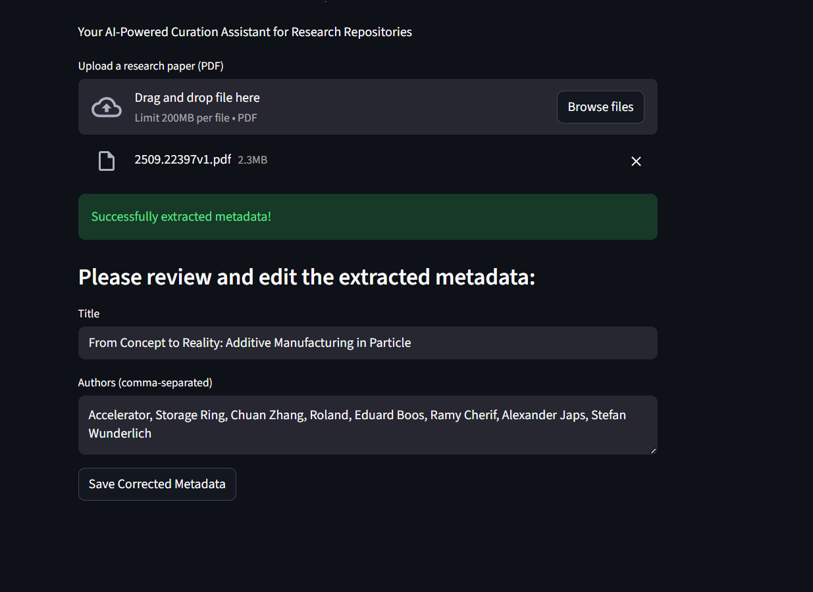

# Intelli-Curate ✨

### An AI-Powered Curation Assistant for Research Repositories

Intelli-Curate is a full-stack application designed to automate and enhance the metadata curation process for scientific documents. It leverages an instruction-tuned large language model (Llama 3.1 8B Instruct) via Hugging Face Inference Providers to extract key information like titles and authors from PDF research papers. The application features a "human-in-the-loop" interface, allowing a user to review and correct the AI's output — every correction is persisted to a local SQLite database, building a dataset for evaluating and improving the extractor.

This project was built as a portfolio piece targeting an AI/ML Engineer role, demonstrating skills in software engineering, AI integration, API development, and modern cloud-based architecture.

---

## 🚀 Key Features

* **AI-Powered Metadata Extraction:** Uses an instruction-tuned LLM (Llama 3.1 8B Instruct) via Hugging Face Inference Providers to extract titles and authors from PDF documents, with structured JSON output enforced via `response_format`.
* **Human-in-the-Loop UI:** A user-friendly web interface built with Streamlit allows curators to instantly review, edit, and validate the AI-generated metadata. Corrections are persisted to SQLite via a dedicated API endpoint, closing the feedback loop.
* **Decoupled Frontend/Backend Architecture:** A robust FastAPI backend serves the AI logic, while a separate Streamlit frontend handles user interaction, demonstrating a scalable, professional software architecture.
* **Cloud-Based AI Model:** Leverages Hugging Face Inference Providers, ensuring high performance and reliability without requiring powerful local hardware. This also demonstrates experience with integrating third-party AI services.
* **Built-in Evaluation:** `eval.py` scores extraction accuracy (title accuracy + author precision/recall/F1) against a labeled set of papers, so improvements are measurable.

---

## 🛠️ Tech Stack

* **Backend:** Python, FastAPI, Uvicorn, SQLite
* **Frontend:** Streamlit
* **AI Service:** Hugging Face Inference Providers (Llama 3.1 8B Instruct)
* **Utilities:** PyMuPDF, `python-dotenv`, `requests`

---

## ⚙️ Setup & Installation

1.  **Clone the repository:**
    ```bash
    git clone https://github.com/vaibhavtiwariz/intelli-curate.git
    cd intelli-curate
    ```
2.  **Create and activate a virtual environment:**
    ```bash
    python -m venv venv
    # On Windows
    .\venv\Scripts\Activate.ps1
    ```
3.  **Install dependencies:**
    ```bash
    pip install -r requirements.txt
    ```
4.  **Create a `.env` file** in the root directory and add your Hugging Face API token:
    ```
    HF_TOKEN="hf_xxxxxxxxxxxxxxxxxxxxxxxxxxxxxx"
    # Optional: override the extraction model
    # HF_MODEL="Qwen/Qwen2.5-7B-Instruct"
    ```

---

## ▶️ Usage

The application requires two terminals to run simultaneously.

1.  **Terminal 1: Start the Backend API**
    ```bash
    uvicorn api:app --reload
    ```
2.  **Terminal 2: Start the Frontend App**
    ```bash
    streamlit run frontend_app.py
    ```
    The application will open in your web browser.

## 📊 Evaluation

Measure extraction quality on your own labeled papers:

1. Drop test PDFs into the `eval/` folder.
2. Copy `eval/ground_truth.example.json` to `eval/ground_truth.json` and fill in the true title/authors per PDF.
3. Run `python eval.py`

It reports per-paper results plus summary title accuracy and mean author F1.

## 🔌 API Endpoints

* `POST /curate-document/` — upload a PDF, get `{"title", "authors"}` back.
* `POST /save-correction/` — store a human-reviewed correction (AI output vs. corrected values) in the local SQLite database. Used by the Streamlit "Save Corrected Metadata" button.

---

## 🎬 Demo

